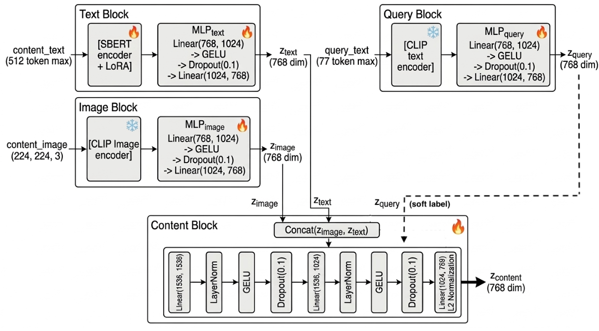

# VibeCrates Recommendation

**English** · [한국어](README_KR.md)

VibeCrates takes a mood as text ("alone on a rainy night", "a calm countryside scene", etc.) and recommends matching movies, music and books. Results are shown as a "board", a collage of their covers.

This repository is the AI recommendation server.
- Inference: API server that turns search text into a 768-dimensional vector
- Training: training of the model that places about 190,000 works in one vector space, and delivery of its output to the backend
- Evaluation: search-quality experiments

User accounts, saved boards and vector search belong to the backend repository; the UI belongs to the frontend repository.

---

## Contents

1. [What this server does in the service](#1-what-this-server-does-in-the-service)
2. [Data](#2-data)
3. [Model](#3-model)
4. [Korean queries](#4-korean-queries)
5. [API](#5-api)
6. [Running locally](#6-running-locally)
7. [Training and evaluation](#7-training-and-evaluation)
8. [Development history](#8-development-history)
9. [Known limitations](#9-known-limitations)
10. [Repository layout](#10-repository-layout)
11. [Documentation](#11-documentation)

---

## 1. What this server does in the service

This server converts search text into a vector. The search itself runs in the backend's vector database (Qdrant).

```
search text
  → frontend → backend
  → AI recommendation server (POST /api/v1/search/vector)
      ① translate to English if Korean
      ② encode into a 768-d query vector
  → backend vector DB (≈180k item vectors, one collection per domain)
      cosine-similarity search with the query vector
  → matching works → board collage
```

Item vectors are precomputed in this repository and delivered to the backend as a bundle (CSV). Query vectors and item vectors must come from the same checkpoint; the `model_version` in API responses and bundle rows identifies it.

The production server runs on a university GPU server (A100) with the API server (8000) and the Gemma translation server (vLLM, 8001).

---

## 2. Data

The item data for the three domains is built by combining the public datasets and APIs below. The combined result is kept as canonical CSVs (`data/canonical/`) in one format, and the pipeline processes those.

| Domain | Items | Cover image coverage |
|---|---:|---:|
| Movies | 39,515 | 99.3% |
| Music | 39,682 | 92.4% |
| Books | 110,594 | 97.0% |

### Data sources

<table>
  <tr><th>Domain</th><th>Source</th><th>Used for</th><th>License</th></tr>
  <tr><td rowspan="2">Movies</td><td><a href="https://www.kaggle.com/datasets/neha1703/movie-genre-from-its-poster">Movie Genre from its Poster</a> (Kaggle, neha1703)</td><td>Item list, IMDb IDs, genres</td><td>See Kaggle page</td></tr>
  <tr><td><a href="https://www.themoviedb.org/">TMDB API</a></td><td>Plot and other metadata, posters</td><td>TMDB terms of use</td></tr>
  <tr><td rowspan="3">Music</td><td>Spotify track audio-feature and lyrics dataset (Kaggle)</td><td>Track list, audio features, lyrics, genres</td><td>—</td></tr>
  <tr><td><a href="https://www.last.fm/api">Last.fm API</a></td><td>Track descriptions</td><td>Last.fm API terms</td></tr>
  <tr><td><a href="https://developers.deezer.com/">Deezer API</a>, <a href="https://musicbrainz.org/">MusicBrainz</a> + <a href="https://coverartarchive.org/">Cover Art Archive</a></td><td>Album covers</td><td>Each service's terms</td></tr>
  <tr><td rowspan="4">Books</td><td><a href="https://www.kaggle.com/datasets/asaniczka/amazon-kindle-books-dataset-2023-130k-books">Amazon Kindle Books Dataset 2023 (130K Books)</a> (Kaggle, asaniczka)</td><td>Item list, categories, cover URLs</td><td>ODC-By</td></tr>
  <tr><td><a href="https://zenodo.org/records/4265096">Best Books Ever Dataset</a> (Casanova Lozano & Costa Planells, Zenodo, DOI 10.5281/zenodo.4265096)</td><td>Item list, blurbs, genres, cover URLs</td><td>CC BY-NC 4.0</td></tr>
  <tr><td><a href="https://www.kaggle.com/datasets/jdobrow/57000-books-with-metadata-and-blurbs">57,000+ Books with Metadata and Blurbs</a> (Kaggle, jdobrow)</td><td>Item list, blurbs</td><td>Not stated</td></tr>
  <tr><td><a href="https://openlibrary.org/developers/api">Open Library API</a></td><td>Covers, categories, ratings</td><td>Open Library terms</td></tr>
</table>

Book data merges the rows with blurbs from the three datasets and removes duplicates (priority Kindle > Goodreads > BX, `scripts/merge_book_sources.py`).

Notice required by the TMDB terms of use: This product uses the TMDB API but is not endorsed or certified by TMDB.

The item text fed to the model is a mood description (`description_synth`) synthesized by an LLM from the original information (plot, blurb, audio features, etc.). All three domains use the same format. Music audio features (energy, valence, etc.) appear in the description as phrases such as "calm" or "intense".

Each item has three training queries: short search phrases generated by Qwen2.5-VL from the cover and description. `scripts/prepare_dataset.py` pairs queries with items into `data/train_dataset.csv`.

Raw data, images, training data and model files are not in the repository (`.gitignore`).

---

## 3. Model

A dual encoder. Items and search text go through separate encoders into the same 768-dimensional space, and the nearest items are found by cosine similarity. Item vectors are stored in advance. At search time only the query is encoded, in tens of milliseconds on a CPU.

### Overall model structure



```
Item side
  mood description → SBERT encoder (all-mpnet-base-v2, LoRA) + MLP → z_text
  cover image      → CLIP ViT-L/14 image encoder (frozen) + MLP    → z_image
  z_text + z_image → ContentBlock → z_content (768, L2-normalized)

Query side
  search text → CLIP ViT-L/14 text encoder (frozen) + MLP → z_query (768)

score = cos(z_content, z_query)
```

### Block inputs and training objective

| Block | Encoder | Input |
|---|---|---|
| Text Block | SBERT (all-mpnet-base-v2, LoRA) | Item description: a mood description synthesized by an LLM from the plot, blurb or audio features |
| Image Block | CLIP ViT-L/14 image encoder (frozen) | Cover image: movie poster, album cover, book cover |
| Query Block | CLIP ViT-L/14 text encoder (frozen) | Expected search text: phrases a user would type to find the item, generated by Qwen2.5-VL from the item's cover and description (three per item) |

Training is contrastive (InfoNCE). Within a batch, the description, cover and expected-query vectors of the same item are pulled together and pushed away from the vectors of other items. After training, the vector of a mood sentence lies near the vectors of items with that mood.

This training scheme maps to the service's intent as follows.

- **Recommendation from a sentence, without behavior logs:** the training signal is item–expected-query pairs, not user behavior logs. The only input needed for a recommendation is one search sentence, and it works the same way for users with no history and for newly added items.
- **One scale across three domains:** movies, music and books are all represented by mood descriptions in the same format and by cover images, and are aligned to the same query space. Scores of items from all three domains for one query are compared on the same scale, so the results can go on one board together.
- **Covers as part of the item representation:** an item's mood shows in its poster, album cover or book cover (colors, composition) as well as in its description. The board is a collage of covers, so training covers against queries makes the covers gathered on a board follow the mood of the query.

Training has two stages (`src/training/trainer.py`).


- **Stage 1 (contrastive):** trains the description, image and query MLP heads and the SBERT encoder's LoRA adapter. The loss is the sum of InfoNCE over three pairs (description–query, description–image, image–query). The description–query and image–query pairs align each source with queries; the description–image pair aligns an item's description with its cover.
- **Stage 2:** trains only the `ContentBlock`, with InfoNCE between the item vector `z_content` and the query vector `z_query`. `z_content` is the vector used for search.
- The CLIP encoders (image and text) are frozen; the SBERT encoder trains only its LoRA adapter.

Serving checkpoint: `best_stage2_qlora_off` (`model_version`: `trained_model.pt@1786697109`)

### Inference (query encoding) model


- Inference model: turns the user's search text (query) into a vector.

---

## 4. Korean queries

The model is trained in English and the CLIP tokenizer is English-only. Korean queries are translated into English on the server before encoding (`src/api/translation.py`), in this order:

1. **Translation dictionary:** if the whole query splits into genre, mood and situation words from the dictionary (`src/api/ko_en_dict.json`, 520 entries), the dictionary translations are joined (로파이 비 오는 날 → *lo-fi rainy day*). Any word missing from the dictionary sends the query to the next step.
2. **Gemma 3 4B:** sentence-style queries are translated by Gemma 3 4B served with vLLM. Active only when `LLM_TRANSLATE_URL` is set.
3. **opus-mt-ko-en:** used when Gemma is not configured or does not respond within the timeout.

If all translation fails, the original text is encoded as is.

The server also detects the domain a query names (`src/api/domain_intent.py`). A noun for a kind of work ("movie", "song", "novel") sets `domain` to `movie`, `music` or `book`; otherwise, or when several domains are named, it is `all`. Genres (jazz, horror) are not used as cues. Full rules are in [`docs/api_for_backend.md`](docs/api_for_backend.md).

---

## 5. API

A FastAPI server. All endpoints are listed at `http://<server>:8000/docs` once it is running. Request and response formats, the bundle format and Qdrant loading are documented in [`docs/api_for_backend.md`](docs/api_for_backend.md) (Korean).

| Method · path | Purpose |
|---|---|
| `POST /api/v1/search/vector` | One query → 768-d vector (used by the backend) |
| `GET /api/v1/search/vector?keyword=…` | Same, via GET |
| `POST /api/v1/embeddings` | Several queries → vectors (to be retired) |
| `POST /api/v1/recommend` | Server-side search results, for cross-checking the backend's search |
| `GET /api/v1/item/{domain}/{item_id}` | Item metadata |
| `GET /api/v1/ping?n=42` | Connectivity check (model-independent) |
| `GET /api/v1/health` | Model and index loading status |

```json
// POST /api/v1/search/vector
{ "text": "잔잔한 영화" }

// response
{ "text": "잔잔한 영화",
  "translated_text": "calm movie",
  "domain": "movie",
  "dim": 768,
  "normalized": true,
  "model_version": "trained_model.pt@1786697109",
  "vector": [0.0023, 0.0258, ...] }
```

Vectors are L2-normalized, so the dot product equals cosine similarity. `translated_text` is set only when a translation happened, and is `null` otherwise.

- CLIP's input limit is 77 tokens; anything beyond is truncated.

---

## 6. Running locally

### Environment

```bash
git clone https://github.com/VibeCrates/VibeCrates_Recommendation.git
cd VibeCrates_Recommendation

python -m venv venv
source venv/bin/activate

pip install -r requirements.txt          # full, including training and experiments
# pip install -r requirements-serve.txt  # API server only
```

### Model and index files

The server uses two sets of files kept outside the repository:
- Checkpoint: `models/trained_model.pt` (about 2.2GB)
- Item vector index: `indexes/{movie,music,book}_embeddings.pt`, `indexes/{movie,music,book}_meta.parquet`

Both must come from the same training run. Without them the server still starts and `/ping` works; the vector endpoints return 503.

### Starting the server

```bash
./scripts/serve.sh            # 0.0.0.0:8000
PORT=9000 ./scripts/serve.sh  # different port
```

`serve.sh` starts the server with the uvicorn inside `venv` and prints the LAN and Tailscale addresses. Startup takes about 13 seconds, during which connections are refused.

| Variable | Default | Meaning |
|---|---|---|
| `MODEL_PATH` | `models/trained_model.pt` | Checkpoint path |
| `INDEX_DIR` | `indexes` | Item vector index folder |
| `DEVICE` | `cuda` or `cpu` | Inference device |
| `TRANSLATE_QUERIES` | `1` | `0` disables Korean translation |
| `LLM_TRANSLATE_URL` | (unset) | Gemma translation server (OpenAI-compatible, e.g. `http://127.0.0.1:8001/v1`). If unset: dictionary → opus-mt |
| `LLM_TRANSLATE_TIMEOUT` | `1.0` | Gemma timeout (seconds) |

### Tests

```bash
pytest tests/        # API, data, domain detection, translation (69 tests)
```

---

## 7. Training and evaluation

### Training pipeline

```
canonical CSV
  → generate_item_descriptions.py / generate_music_descriptions.py   synthesize mood descriptions (vLLM)
  → generate_queries.py                                             3 training queries per item (Qwen2.5-VL)
  → prepare_dataset.py                                              data/train_dataset.csv
  → extract_image_embeddings.py                                     cover image embeddings
  → train.py                                                        two-stage training + index build
  → convert_bundle_csv.py --require-image                           item vector bundle for the backend
  → export_query_vectors.py                                         training query vectors for the backend
```

```bash
python scripts/train.py \
    --data-path data/train_dataset.csv \
    --image-embeddings <.pt produced by extract_image_embeddings.py> \
    --sample-one-query \
    --save-path models/trained_model.pt \
    --index-dir indexes
```

`--sample-one-query` uses one of each item's three training queries, chosen at random each step (serving-model setting). Other experimental flags (`--query-lora`, `--title-dropout`, `--domain-balanced-batches`, etc.) are listed in `python scripts/train.py --help`.

### Evaluation

Two models (checkpoint + index) are run on the same evaluation queries and compared.

- **Pairwise judging:** `scripts/judge_pairwise.py` shows the two models' results side by side to an LLM judge (Qwen2.5-VL-7B by default), which picks the better one. Each pair is asked twice with the order swapped; the output is a win rate and p-value.
- **Human labels:** `scripts/build_label_sheet.py` builds a label sheet and `scripts/score_label_sheet.py` tallies it.

Experiment outputs are in `experiments/`; experiment reports are in `docs/`.

---

## 8. Development history

| Period (2026) | Stage | Work |
|---|---|---|
| 05-06 | Model design | Dual-encoder structure (TextBlock, ImageBlock, QueryBlock, ContentBlock) and two-stage training losses |
| 05-20 – 05-22 | Data exploration | Survey of the movie, music and book source CSVs, IMDb ID cleanup, image URL validation |
| 05-20 – 05-31 | Data collection | Book descriptions (Google Books), music descriptions (Last.fm), music covers (MusicBrainz), image download pipeline, book data switched to Kindle 2023 |
| 05-29 | Implementation | Preprocessing, evaluation, inference, query-based API |
| 05-31 – 06-15 | Training data generation | Training queries per item with Qwen2.5-VL-7B; query language switched from Korean to English |
| 06-16 – 06-18 | Training | Training dataset assembly, precomputed CLIP image embeddings, first training run, early stopping, checkpoints, index build |
| 06-18 | Evaluation | Recommendation quality evaluation for Korean and English queries |
| 07-06 – 07-16 | Data processing | Canonical CSVs, TMDB movie metadata merge, music text diagnosis, mood description synthesis trial |
| 08-03 – 08-07 | Data processing | Book data rebuilt from three sources, mood descriptions for all three domains synthesized with vLLM on a GPU server, training queries regenerated, pre-training QA |
| 08-13 – 08-18 | Model improvement, training | Stage 2 loss replaced with InfoNCE, one-query sampling, CLIP freezing fix, title/field-name dropout experiments |
| 08-14 – 08-31 | Serving | Backend integration, query-vector endpoints, item vector delivery bundle, Korean query translation, extra music covers (Deezer) |
| 09-01 – 09-09 | Data processing, evaluation | Duplicate item removal, pairwise LLM judging, per-domain cap rule |
| 09-11 – 09-23 | Evaluation, training | Human label sheets, domain-balanced batch and field-name unification experiments, popular-item extraction, items without covers dropped from the bundle |
| 10-08 – 10-15 | Evaluation, serving | Judge validation, energy-axis measurement, training query vector bundle, Korean translation dictionary, domain detection |
| 10-23 – 10-31 | Serving, analysis | Move to the university GPU server, Gemma 3 4B sentence translation, retraining (newbase), model issue list, negation measurement |

---

## 9. Known limitations

- **Negation:** "fantasy novels that are not scary" maps close to "scary fantasy novels". This comes from the frozen CLIP text encoder.
- **Metaphorical sentences:** for metaphorical queries, the meaning of the translation sometimes differs from the meaning of the original.

Causes and current status are in [`docs/model_issues.md`](docs/model_issues.md).

---

## 10. Repository layout

```
VibeCrates_Recommendation/
├── src/
│   ├── api/                 # FastAPI server: routes, model loading, translation, domain detection
│   ├── models/              # Dual encoder (TextBlock, ImageBlock, QueryBlock, ContentBlock)
│   ├── training/            # Two-stage trainer, InfoNCE loss, training history
│   └── data/                # Dataset, loaders, preprocessing
├── scripts/                 # Data collection/synthesis, training, index/bundle export, evaluation, serving
│   └── vibe_crate/          # Main and board screen design mockups (static HTML)
├── data/canonical/          # Canonical per-domain CSVs (raw data, images, training data are gitignored)
├── experiments/             # Experiment outputs and human label sheets
├── docs/                    # Design notes, API guide, work logs, session reports
├── reports/                 # Early session reports (sessions 1–20)
├── tests/                   # pytest
├── Dockerfile, docker/      # Serving container
├── requirements.txt         # Full dependencies, including training and experiments
└── requirements-serve.txt   # API server dependencies only
```

---

## 11. Documentation

Most documents are in Korean.

| Document | Contents |
|---|---|
| [`docs/api_for_backend.md`](docs/api_for_backend.md) | Backend integration: endpoints, bundle format, Qdrant loading, per-domain cap rule |
| [`docs/model_issues.md`](docs/model_issues.md) | Model issue list (resolved / not affecting the service / kept / unconfirmed) |
| [`docs/worklog_2026-07_to_09.md`](docs/worklog_2026-07_to_09.md) | Work log, July–September |
| [`docs/worklist_2026-09-03.md`](docs/worklist_2026-09-03.md) | Task list as of September |
| `docs/report_session_*.md` | Session reports, September–October (latest: [`2026-10-31`](docs/report_session_2026-10-31.md)) |
| [`docs/design_poet_style_alignment.md`](docs/design_poet_style_alignment.md), [`docs/design_audio_feature_integration.md`](docs/design_audio_feature_integration.md) | Design notes |
| [`docs/report_judge_validation_20261009.md`](docs/report_judge_validation_20261009.md) | LLM judge validation results |

---

## License

MIT License

## Contact

maxsky9018@gmail.com
